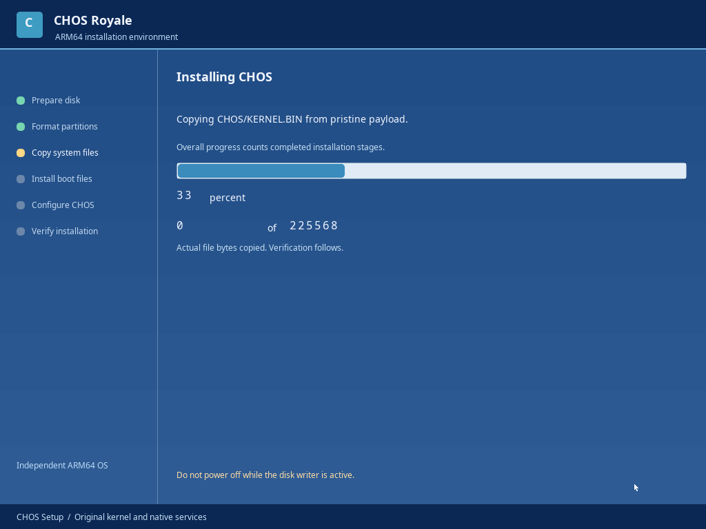

# M6D continuation — dedicated native installation environment

This resumes the complete source checkpoint `08562eb`, after verifying a clean
tracked-source build reproduced its published M6D ISO byte for byte. The earlier
M6D widget/configuration ISO is preserved. Existing kernel, drivers, filesystems,
native applications and approved Royale identity remain. No project restart or
replacement kernel/UI framework was introduced.

## Milestone status

The persistent installer core already wrote verified GPT/FAT32/CHFS, installed
ARM64 boot files, cold-booted without the ISO and retained native file saves.
This iteration turns that core into the requested dedicated full-screen setup
experience and strengthens inventory, progress, read-back and failure coverage.
Milestone 6's installation core is functional; complete account/authentication,
regional/display configuration and repair are still open. M7 Fusion and M8 release
readiness are not marked complete.

Completed engineering:

- Optical boot launches only Setup, without first starting desktop apps/chrome.
  Explicit L/F3 opens Live Desktop. Disk-only boot opens the persistent desktop.
- Blue welcome/agreement/disk/layout/typed-confirmation pages; native full-screen
  Royale configuration/progress/error/completion, shared original controls/fonts.
- Exclusive Setup input and full framebuffer dimensions. Start, Alt-Tab and
  window controls cannot interrupt confirmation. Returning restores existing apps.
- Read-only NVMe inventory, precise capacity policy, namespace write-protection
  check, primary GPT CRC/bounds/nonoverlap and existing partition summaries.
- The original 128 MiB planning gate is removed. The actual fixed layout needs
  69 MiB + 20 KiB (512-byte sectors) or 277 MiB + 20 KiB (4096-byte sectors).
- Actual worker stages and successful payload bytes drive progress. Stage changes
  synchronize with displayed native frames through a bounded cooperative yield;
  no fake copy timers or remaining-time estimates are used.
- Final verification compares all system configuration/license/welcome files and
  exact boot/kernel payloads. A successful installation log is written and read
  back. Restart is tested through QMP guest-reset; installed boot uses the standard
  ARM64 EFI fallback path without a firmware NVRAM entry.

Configuration is deliberately collected before destructive writes, allowing safe
correction/cancellation. GPT preparation is the blue operation phase, followed by
full-screen graphical FAT32/CHFS formatting, payload copying, configuration and
verification. No nonfunctional password screen is shown. Details:
[flow, architecture, capacity, progress and safety](setup-environment.md).

## Installation status

| Capability | Scope |
|---|---|
| Disk detection and inventory | One original NVMe controller/namespace; actual block reads and serial/geometry |
| Destructive authorization | Optical boot, exact serial/capacity review, staged valid settings, owner/token and typed ERASE |
| GPT partitioning | Primary/backup headers and arrays, protective MBR, read-back verification |
| Formatting | Original FAT32 ESP and CHFS system volume |
| System/boot file copy | Pristine kernel containing native apps and original BOOTAA64.EFI; exact read-back |
| Configuration and log | CRC-checked system settings, licenses, welcome, completed-check log |
| Disk-only reboot/persistence | Native installs and user files/settings tested across fresh VMs; ISO absent |
| Failure/recovery | Real NVM write error, stopped worker and explicit retry tested; no fsck/rollback |
| VMware Fusion | Not run; no target host, EL2/GICv3/USB blockers remain |

Live Desktop remains RAM backed, including after an installation finishes in that
live boot. Reboot from the target to mount persistent storage. Installed sessions
have no live-session overlay; failed mounts explicitly identify temporary RAM.

## GUI status and actual screenshots

The desktop retains approved wallpaper, original icons, fonts, blue taskbar and
Start organization. Maximized windows show the restore glyph. The new setup has
original CHOS branding, readable blue text pages, stage sidebar, aligned controls,
actual status/progress, error guidance and completion. Explorer, Notepad and Task
Manager are exercised together; menus/dialogs and preserved desktop apps remain.

All captures below are lossless framebuffer output from running native CHOS,
not generated artwork or host-rendered mockups.

| Required scenario | Actual capture |
|---|---|
| Blue installer boot | [Welcome](evidence/m6d-setup/setup-blue-512.png) |
| Disk selection and destructive confirmation | [Destination](evidence/m6d-setup/setup-destination-512.png), [confirmation](evidence/m6d-setup/setup-confirmation-512.png), [layout](evidence/m6d-setup/setup-layout-512.png) |
| Graphical configuration and real progress | [Configuration](evidence/m6d-setup/setup-configuration-512.png), [progress](evidence/m6d-setup/setup-progress-512.png) |
| Verified installation completion | [Complete](evidence/m6d-setup/setup-complete-512.png) |
| First installed boot without ISO | [Installed desktop](evidence/m6d-setup/installed-desktop-512.png), [clean saved desktop](evidence/m6d-setup/installed-clean-desktop.png) |
| Explorer, Notepad and Task Manager together | [Three native apps](evidence/m6d-setup/workspace-three-apps.png) |
| CHOS Start and Control Panel | [Start](evidence/m6d-setup/royale-start.png), [Control Panel](evidence/m6d-setup/settings-saved.png) |
| Failure/interruption/retry | [NVMe error](evidence/m6d-setup/setup-io-error.png), [interrupted](evidence/m6d-setup/setup-interrupted.png), [existing GPT](evidence/m6d-setup/setup-existing-gpt.png), [retry completion](evidence/m6d-setup/setup-retry-complete.png) |
| Capacity/recovery/minimum display | [Too small](evidence/m6d-setup/setup-too-small.png), [recovery status](evidence/m6d-setup/setup-recovery-status.png), [640×480 configuration](evidence/m6d-setup/setup-config-640.png) |



Screenshots were inspected for clipping, typography and stage consistency. A
progress-refresh defect initially skipped straight to completion; real stage/frame
synchronization fixes that. The three-app capture was rearranged to keep Task
Manager's counters visible. Setup configuration/confirmation is exercised at
640×480. Small ordinary app windows can still clip fixed toolbars/metrics, and
higher-level toolkit behavior remains incomplete; this is not a commercial-quality
or complete responsive-layout claim. Green installed screenshots reflect an
explicitly selected saved theme, not a redesign of default Royale blue.

## Build and testing

```sh
./scripts/container.sh image
./scripts/container.sh make
./scripts/container.sh bash scripts/validate.sh
bash scripts/sanitize.sh
```

The sequence requires 35 real QEMU AArch64 UEFI cases and 13 portable host C
programs, both actual ELF payloads, ISO/disk repeatability, independent wire-format
parsers and ASan/UBSan. Dedicated tests use only newly created regular disposable
disk image files; no host block device or user-data disk is attached.

The first regression exposed a test's fixed PID assumption: initial Setup adds
one legitimate process. It now checks native app roles and observed PID lifecycle.
Compiler warnings in new host test/inventory formatting were corrected. Final
review also fixed a progress acknowledgment race by binding acknowledgment to
the painted phase and queueing refresh before wake; the full sequence was rerun
after this correction. Runtime
failures are not hidden or represented as successful evidence.

Final test results, hash/size and measured memory/timing are recorded below after
completion of the current sequence.

## Source files and next steps

New portable read-only inventory: `installer/inventory.c`; new host inventory
coverage and native setup flow/minimum-mode tests under `tests`. Updated original
`applications/setup/main.c`, common app runtime/event pump, compositor/window model,
installer service, GPT/FAT32 observer/planning, NVMe write-protection state, public
headers and the private scheduler yield. Build/validation/sanitizer scripts and
architecture/ABI/status/installation docs are updated. Earlier original writers,
pristine payload retention, ELF isolation and confirmation authority remain.

Next engineering work: finish account/authentication design with a credential
format and authority model before adding password UI; add supported regional/
display configuration and repair/logging failure behavior; implement target
EL2/GICv3/USB support based on an actual Fusion inventory. Next visual work:
responsive app toolbars/metrics and remaining shared menu/focus/file-picker
behaviors. No Apple Silicon/Fusion host is available, so target validation remains
an explicit blocker. Networking/SMP and CHOS 0.1 release testing remain later work.
