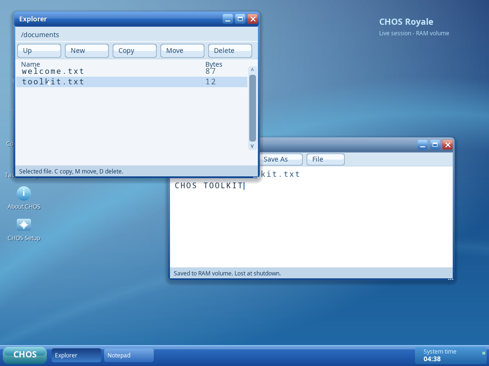

# Milestone 6D — saved configuration and shared native widgets

This continues M6C (`5135d388e68145b0bb3c2fa3b4b8ea1d2953c825`, stable tag
`checkpoint/milestone-6c`). The approved Royale wallpaper, two-column menu, icons,
fonts, branding and blue taskbar remain. The kernel/window/process architecture
is retained. This is an engineering checkpoint, not CHOS 0.1 or Fusion validation.

## Engineering progress

M6C already installed to a virtual disk and cold-booted without an ISO in QEMU.
That path was preserved. The next unfinished task was persistent system settings.

- Original versioned, CRC-checked 80-byte configuration record; explicit wire
  encoding, bounded names/options, fixed-offset clock wrapping and reserved fields.
- Setup stages computer/theme/clock preferences before the separate typed disk
  confirmation; staging and invalid input do not write the disk. Back corrects an
  invalid name, and errors remain visible. Shared Back/Continue/Restart controls
  retain the existing native worker and boot-medium/identity safety checks.
- Control Panel edits computer name, theme, clock seconds and offset through native
  tabs/fields/radio/checkbox widgets. Installed Save uses a whole-file CHFS commit;
  active settings change only on success. Live Apply is explicitly volatile.
- Installed boot reads the canonical record; legacy installations read the old
  computer-name file without an automatic migration write. Bad configuration has
  specific diagnostics and a temporary-RAM fallback; no formatting/repair occurs.
- Queued dialog input binds before first paint, avoiding split caret state. Modal
  dismissal clears the old registry. The native event pump drains up to 32 pending
  events before repainting; layout changes force a paint. Client queues grow to
  128 with pointer coalescing, explicit release capture and release/close priority.
- Independent Virtio queues have no common timestamp. Within one poll, pointer
  changes precede typing, preserving each stream's order. This handles click-then-
  type consistently. Host tests verify the ordering and bounded overflow behavior.
- Shadow painting omits the opaque covered center. A pixel comparison against the
  previous full-area algorithm verifies the same visible result.

See [configuration format, persistence and failure semantics](configuration.md).
A final flush failure can leave an old or new complete record; full rollback is
not promised. Configuration CRC is corruption detection, not authentication.

## GUI improvements

A shared original C widget library supplies buttons, labels, bounded text fields,
checkboxes/radios, scrollbars, list rows, menu panels/items, dialogs, progress bars,
tabs and toolbars. Appearance and interaction live in the library and centralized
Royale tokens. Explorer, Notepad, Control Panel and Setup use those controls.

Notepad has a real File menu and pointer-operated modal actions. Explorer selects
real entries, enables file operations only when selected and scrolls actual
filesystem contents. The shell adds release/cancel states, refined hover/active
buttons, selected desktop icons, and an All Applications Back action with arrow
navigation. Normal installed sessions no longer have the permanent desktop overlay;
About reports computer/volume information. See [toolkit architecture](gui-toolkit.md).

Actual guest screenshots (lossless QEMU framebuffer captures):

| Scenario | Capture |
|---|---|
| Explorer and Notepad arranged with real file selection | [Overlapping apps](evidence/m6d/workspace-arranged.png) |
| File menu and native Save As dialog | [Menu](evidence/m6d/workspace-file-menu.png), [dialog](evidence/m6d/workspace-save-dialog.png) |
| Hover, press and cancelled activation | [Hover](evidence/m6d/workspace-button-hover.png), [pressed](evidence/m6d/workspace-button-pressed.png) |
| Minimized and maximized Notepad | [Minimized](evidence/m6d/workspace-minimized.png), [maximized](evidence/m6d/workspace-maximized.png) |
| Real directory scrolling and Terminal file operations | [Explorer](evidence/m6d/workspace-scrolled-files.png), [Terminal](evidence/m6d/workspace-terminal-files.png) |
| Actual process/memory counters | [Task Manager](evidence/m6d/workspace-tasks.png) |
| Native Setup, preferences and completion | [Destination](evidence/m6d/workspace-setup.png), [configuration](evidence/m6d/setup-configuration-512.png), [completion](evidence/m6d/setup-complete-512.png) |
| Saved settings and installed desktop | [Control Panel](evidence/m6d/settings-saved.png), [cold boot](evidence/m6d/settings-cold-boot.png), [clean desktop](evidence/m6d/installed-clean-desktop.png) |
| Specific invalid-record recovery | [Warning](evidence/m6d/settings-invalid-record.png) |



## Build and tests

```sh
./scripts/container.sh image
./scripts/container.sh make
./scripts/container.sh bash scripts/validate.sh
bash scripts/sanitize.sh
```

The expanded validator requires **29 real QEMU boots and twelve host programs**,
both actual ELF payloads, ISO/disk repeatability, ASan/UBSan and independent
GPT/FAT32/CHFS/configuration parsers. All writable disks are disposable image files.

Native installation runs at both 512/4096-byte sectors. Each test rejects invalid
configuration, corrects it with Back, rejects wrong ERASE confirmation, then
installs. Two disk-only VMs verify the computer/settings record, exact saved file
bytes and boot-disk erasure exclusion. The new settings test adds four boots:
invalid-save no-write plus native valid save/shutdown; cold configuration/user-data
reopen; legacy boot without migration writes; and invalid configuration inside a
valid CHFS, with unchanged disk hash. The workspace VM demonstrates actual native
menus/dialogs, multiple windows, file selection/scrolling, fast bounded input and
cross-process saved contents, Task Manager and Setup inventory without disk writes.

Host tests include record mutation/range checks, failures at each write/flush save
boundary, old-or-new record recovery, pre-paint text entry, modal dismissal,
press/release cancellation, disabled/focus/scroll behavior and capture/queue bounds.
Machine-readable results, logs and captures are in [evidence/m6d](evidence/m6d).

Recorded result: **all 29 QEMU cases and twelve host programs passed** (26
positive boots, three expected rejections). ASan/UBSan, ISO/disk repeatability,
installed file/configuration bytes, invalid-input hashes and corruption/legacy
read-only checks passed. The four configuration VMs were repeated successfully
to capture the installed desktop after About had fully closed.

ISO: 17,154,048 bytes, SHA-256:

```
3e78748a915480308645759917aa6e9d2ffcb3492d40e968baf4456c60077923
```

At 512 MiB the two-app acceptance reported 14,696 KiB allocated from
489,344 KiB managed conventional RAM. Desktop readiness was 15.393
seconds including UEFI/TCG and diagnostics. Linked kernel text/data/BSS totals
403,458 bytes; the application text segment remains below the loader's 64 KiB
limit. These are scoped observations, not total physical footprint, native timings
or idle CPU. Default Royale blue is unchanged; the installed settings screenshots
use Harbor green because the test explicitly selects and persists it.

| Acceptance | Result |
|---|---|
| ISO generation / UEFI optical structures | PASS |
| QEMU boot / native desktop and apps | PASS |
| Native installation / disk-only reboot | PASS, both sector geometries |
| Saved files and settings after shutdown/cold boot | PASS |
| Native menus/dialogs/multi-window use | PASS |
| VMware Fusion boot/input/display/install/reboot | NOT RUN |

[Versioned ISO and download instructions](../artifacts/milestone-6d/README.md).

## Source changes

New configuration modules under `kernel/config`, `include/config.h`, common GUI
library under `userspace/libraries/gui`, `include/gui.h`, and configuration/GUI/
settings/workspace tests. Updated original installer service/presentation, native
app event pump/toolbars/menu/settings, desktop/window-manager/input dispatch,
shared Royale tokens, additive syscall ABI and build/validation/sanitizer scripts.
The existing UEFI loader, ELF isolation, scheduler, NVMe driver/storage formats,
original payload copying and destructive-install safeguards remain in use.

## Remaining issues and next milestone

**VMware Fusion remains unverified:** no Apple Silicon/Fusion host is attached.
QEMU devices are not a Fusion inventory. EL2 entry, GICv3 and USB/xHCI still need
support/target evidence; the existing Fusion validation procedure remains required.

No user/password authentication or filesystem access-control boundary exists.
Settings are per-system. The clock offset has no DST/IANA zone rules. Setup still
lacks keyboard-layout/graphical display selection, active-write cancellation,
repair/fsck and full rollback. Search/Help remain documented shortcuts rather than
complete dedicated services. The toolkit lacks richer text/clipboard, file-picker
browsing, popup dismissal, full radio keyboard groups, responsive toolbar overflow
and accessibility infrastructure. Small windows can clip toolbar controls; keyboard
shortcuts remain available. Networking, SMP and release-0.1 readiness remain open.

Next: continue installer configuration and recovery with the shared controls,
resolve remaining menu/toolkit behaviors, and add target hardware support before
actual Fusion validation. Preserve the approved visual design and native app tests.
