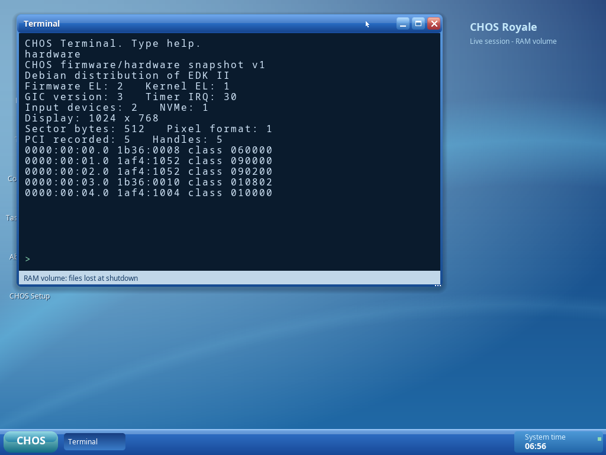

# M7A/7B — boot and interrupt compatibility checkpoint

**Original EL2→EL1 startup and ACPI GICv3 are implemented and tested. All 45 QEMU
cases and 14 portable host programs passed**, with ASan/UBSan and clean-source ISO
reproduction. This is an intermediate Milestone 7 iteration. **Fusion was not
run; actual target input/storage/display compatibility and Milestone 7 completion
remain open.** No Apple Silicon/Fusion host is available.

## Recovery and audit

Recovered published `ed343cf0e862106879ddd8aab2a03f34a5712a4c`, checked the clean
working tree and prior milestone documentation/evidence, and created
`checkpoint/milestone-7-start` before changes. No later work was discarded.
A separate clean `git archive` rebuilt that baseline and independently reran all
35 QEMU cases/13 host programs. The baseline ISO exactly matched published SHA-256
`d97d3e5c923cd2baa75ecc7a1036c9d0c61c0fcdfd817a19fa714297988e8300`.
See [baseline validation](evidence/m7ab/baseline-validation.log).

The audit confirmed EL1-only startup and GICv2-only discovery as actionable kernel
limitations. Actual Fusion device topology could not be confirmed: direct vendor/
specification web retrieval was blocked by the workspace proxy, and reviewed Git
sources did not establish a Fusion inventory. [The matrix](fusion-compatibility-matrix.md)
records sources, unknowns and required changes. QEMU device addresses and x86
VMware assumptions were not copied into generic discovery.

## Implemented work

- Original EL2 entry preserves firmware identity mappings/cache attributes while
  converting stage-1 TTBR0/TCR/MAIR for EL1, sets privilege/trap/counter/timer/GIC
  controls and ERETs to masked EL1h. EL1 entry is retained. VHE, LPA2/52-bit,
  MMU-off and big-endian EL2 handoffs are explicitly unsupported. Existing kernel
  exception/MMU/protection/context-switch tests run after the actual transition.
- Bounded ACPI MADT GICv3 distributor and redistributor discovery, direct GICC GICR
  or MPIDR-matched ranges, affinity/stride/Last handling, RAM/overlap/alignment bounds,
  distributor/redistributor initialization, Group-1 NS priority/trigger/mask/routing,
  CPU system registers, timer acknowledge/EOI and timed RWP/wake failure handling.
  GICv2 remains tested. One boot CPU only; no ITS/LPI/MSI or SMP claim.
- Read-only standard UEFI PCI inventory before final memory-map/exit, bounded
  firmware vendor/entry EL, immutable native hardware snapshot and validated
  syscall 33. Terminal `hardware` reports actual initialized EL/GIC/timer/input/
  NVMe/GOP and PCI IDs. Its QEMU output matched independent QMP PCI inventory;
  diagnostics left an unconfirmed disk unchanged. This is not a USB driver.
- Shared tested binary-size formatting for Setup capacity, partition, logical-sector
  and copied/total-byte labels. Existing blue/Royale geometry, controls, theme,
  real progress and destructive confirmation are preserved.
- [Account architecture](accounts-design.md) defines UID/authority/store/hash/session
  prerequisites and a licensed Argon2id integration candidate. It is design only;
  no password UI, credential store, authenticated login, ACL or new security claim.

## Build and verification

Runtime/source checkpoint: `e31283e`. A separate clean archive of that commit built
both EFI/kernel and all 14 host programs, validated both real ELF payloads and
reproduced the tested ISO byte for byte. [Clean build log](evidence/m7ab/source-package-build.log).
The existing Docker image provides Clang/LLD 19.1.7, QEMU 10.0.13, AArch64 UEFI and
xorriso 1.5.6; [tool versions](evidence/m7ab/toolchain.log).

```sh
./scripts/container.sh image
./scripts/container.sh make -j4 iso
./scripts/container.sh bash scripts/validate.sh
bash scripts/sanitize.sh
```

The final expanded suite passed:

| Coverage | Actual result |
|---|---|
| Baseline core 512 MiB/1 GiB, exception/MMU/EL0/IPC/input | Pass |
| Additional real UEFI EL1/GICv3, EL2/GICv2, EL2/GICv3 | Pass; observed firmware EL retained in logs/JSON |
| Native install plus two disk-only boots at each sector size | Pass for EL1/GICv2 and EL2/GICv3: 12 VMs total |
| Typed confirmation, selected identity, no premature write, self-erasure refusal | Pass |
| Payload/GPT/FAT32/CHFS/configuration checks and persistent native file saves | Pass; independent parsers and cold boots |
| Original filesystem create/delete/directories/repeated replacement/remount/CRC/full-entry/torn-write/flush fallback tests | Pass; bounded failure model, not production crash proof |
| Actual NVMe write error, active installation interruption, explicit retry | Pass; no false success |
| 70 MiB native installed boot, too-small no-write refusal, 640×480 Setup | Pass |
| Multi-window apps/widgets/settings, mode selection/fallback, corrupt-volume no-write warning | Pass |
| Native hardware snapshot/QMP PCI comparison and untouched disk | Pass |
| 14 host programs, both ELF payloads, ASan/UBSan | Pass |
| ISO repeatability, builder-disk repeatability, clean tracked-source reproduction | Pass |
| VMware Fusion boot/input/install/disk-only reboot | Not run; blocked by missing target host/inventory |

[Full validation log](evidence/m7ab/validation.log),
[sanitizers](evidence/m7ab/sanitizers.log),
[machine-readable summary and capture hashes](evidence/m7ab/summary.json).
Forty-five counts actual QEMU instances: 5 core EL/GIC boots, 5 desktop/application/
Royale/workspace/restart, 2 expected platform/kernel refusals, 5 storage cases,
2 builder-disk boots, 12 native install/installed boots, 1 hardware probe,
5 Setup failure/capacity/retry cases, 4 configuration cases, 1 corrupt-volume,
1 minimum-mode Setup and 2 alternate-mode cases. All disks are disposable regular
image files; no host block device is used.

The current ISO is **17,154,048 bytes**, SHA-256:

```
3dd72a4a960cd7aead275e8a399830a50acea0b3107dd078310cadc82c499549
```

[Versioned ISO/download instructions](../artifacts/milestone-7a-b/README.md).
All previous artifacts remain preserved. No CHOS 0.1 or Milestone 7 completion tag.

## Actual GUI captures and measurements

99 native guest PNGs from the final suite are published with hashes. These are
framebuffer captures of the original OS, not generated artwork or browser mockups.
Inspected hardware, size labels, progress and minimum-mode configuration for text
fit and stage consistency. Existing fixed-size ordinary app limitations remain.

| View | Capture |
|---|---|
| Actual firmware EL2 / kernel EL1 / GICv3 diagnostics | [Hardware](evidence/m7ab/hardware-probe.png) |
| Binary disk capacity and logical-sector labels | [Destination](evidence/m7ab/setup-destination-512-gic3-el2.png) |
| Proposed partition sizes and explicit confirmation | [Layout](evidence/m7ab/setup-layout-4096-gic3-el2.png), [ERASE](evidence/m7ab/setup-confirmation-4096-gic3-el2.png) |
| Real installation stage/byte progress | [Progress](evidence/m7ab/setup-progress-4096-gic3-el2.png) |
| Verified completion / installed file reopen | [Complete](evidence/m7ab/setup-complete-4096-gic3-el2.png), [reopen](evidence/m7ab/installed-notepad-reopen-4096-gic3-el2.png) |
| Minimum Setup configuration | [640×480](evidence/m7ab/setup-config-640.png) |
| Preserved Royale apps/Start/Control Panel | [Three apps](evidence/m7ab/workspace-three-apps.png), [Start](evidence/m7ab/royale-start.png), [settings](evidence/m7ab/settings-saved.png) |



At 512 MiB the two-app test observed **14,712 KiB allocated conventional RAM out
of 489,320 KiB managed**. Desktop readiness was **14.926 seconds**, including UEFI,
kernel self-tests and explicit live selection under QEMU TCG. Allocator figures
exclude unmanaged/firmware reservations; this is not total guest resident memory.
The hardware probe observed the emulated vCPU host thread consume **0.71 CPU
seconds over 10.0 seconds (7.1% of one host core)** while Terminal/Desktop idled.
That measures QEMU TCG thread cost, not native guest idle percentage or Fusion
performance. Rendering/interrupt overhead and timer drift remain optimization work.

Linked kernel text/data/BSS totals **423,562 bytes**, below the 512 KiB bootstrap
limit. The app ELF text is **40,776 bytes**, below its 64 KiB load-segment limit;
its total text/data/BSS is 66,080 bytes across separate segments.
[Linked sizes](evidence/m7ab/linked-sizes.log).

## Changed files, blockers and next action

Boot/platform changes: `boot/uefi/{efi.h,main.c}`, `kernel/arch/arm64/{entry.S,acpi.c,hardware.c}`,
`kernel/main.c`, `drivers/interrupts/{gicv3.c,gicv2_timer.c}` and platform/boot/GIC/
timer/hardware headers. ABI/runtime changes: `include/abi.h`, `kernel/syscall/syscall.c`,
Terminal, About and app startup checks. GUI changes: `include/gui.h`, shared
`userspace/libraries/gui/widgets.c` and `applications/setup/main.c`. Build/test
changes: Makefile, validation/sanitizer scripts, ACPI/GIC/GUI/boot/install tests,
Guest configuration and `tests/platform_probe.py`. README/status/architecture/
ABI/acceptance/release/matrix/manual/account/report docs and versioned evidence
are updated. See source commit for the exact diff.

Next engineering action is **7C target inventory and the required input driver**:
obtain the exact Fusion release/firmware boot diagnostics, PCI IDs and USB/HID
reports, then implement the observed controller/protocol and validate real input.
Storage/display and complete installation must pass on that host before marking
7C/7D complete; [manual checklist](fusion-validation.md). The QEMU installer tests
are regression evidence, not advancement past a failed Fusion prerequisite.

Accounts/entropy/ACL implementation, full regional/display setup, repair/fsck/
rollback, responsive small app layouts, SMP/networking and release reliability
remain open. GICv3 and EL2 have tested bounded support, not universal hardware
coverage. No claim of Fusion operation, complete authentication or production
filesystem durability is made.
