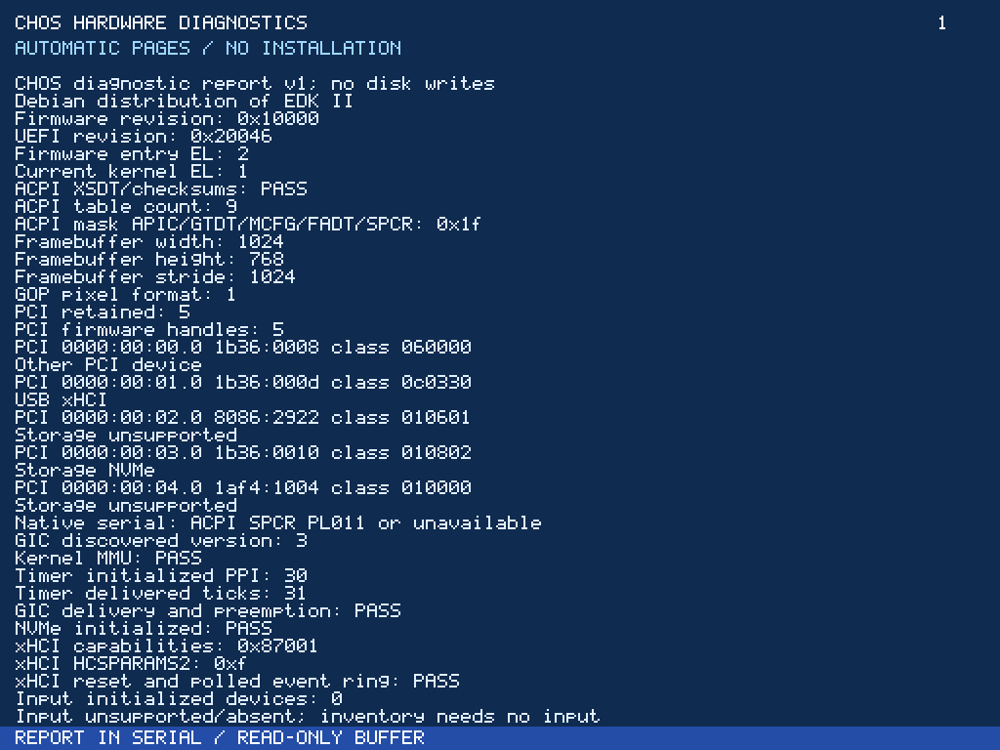

# M7C — automatic discovery and initial native USB input

This iteration adds an unattended diagnostic ISO and an original bounded xHCI
USB boot-keyboard/mouse path. **Fusion was not run: no Apple Silicon/Fusion host
is attached.** This is an intermediate M7C checkpoint. USB interrupts, additional
controllers/protocols, broader recovery and actual target acceptance remain open.

## Preserved state and implemented work

Started from clean published `71c8565`, reviewed the existing matrix/checklist and
created `checkpoint/milestone-7c-start`. No later work was discarded. The previous
M7A/7B images and source/evidence remain unchanged. Runtime/source checkpoint for
this iteration: `ac095e6`.

The new **CHOS-ARM64-M7C.iso** uses the same original UEFI loader/kernel with an
explicit diagnostic marker. It automatically displays a paged inventory without
keyboard/mouse input, stays out of Setup, and skips system-filesystem mounting/
formatting. The separate normal **CHOS-ARM64.iso** retains the approved blue/Royale
installer and explicit L/F3 Live Desktop choice. Neither mode silently installs.

Automatic reports include bounded firmware vendor/revision and UEFI revision,
actual firmware/kernel EL, validated ACPI table count/mask, GIC version and delivery,
timer PPI/ticks, GOP geometry/format, PCI BDF/vendor/device/class/subclass/interface,
USB/storage classification, and actual driver successes/failures. Unsupported
controllers remain visible rather than being probed as an assumed known device.
Original native UART output uses a validated ACPI SPCR PL011 address after kernel
mapping, never a hardcoded QEMU address or a post-exit firmware callback. Firmware
console output remains available before exit. Missing/unsupported UARTs leave the
framebuffer report available; no serial output is fabricated.

A sanitized append-only 16 KiB report has bounded read-only syscall export. Native
apps test valid/invalid export spans. It accepts no arbitrary memory address, disk
path or raw device write and never includes password input or HID key contents.
If full, it discards later text; it is not a persistent crash logger. Early boot
failures still use existing UEFI errors/red kernel diagnostics; not every firmware
failure can produce a native serial report. Final ExitBootServices failure retains
the existing no-further-firmware-calls halt behavior.

Original USB code separates portable descriptor/HID/ring/DMA validation from
xHCI register access. PCI class-based discovery uses the existing MCFG/BAR/MMIO/
PMM facilities. The controller halts/resets with bounded waits, sets command/event
rings and endpoint contexts, enumerates USB2 root devices, selects boot protocol,
and feeds existing CHOS input events. Eight distinct DMA receive buffers per device
avoid single-transfer starvation during rendering. Ring publication uses release
fences, consumption acquire fences, and native cache/barrier maintenance.

Only one AC64 controller, two successful direct-root boot-HID devices, low/full/
high speed, no scratchpads and bounded configurations/packets are supported.
Completion is **polled**; no MSI/MSI-X/INTx or USB interrupt-delivery claim. Unsupported
controllers, non-boot HID and initialization failures log bounded errors and
continue diagnostics. Disconnect releases held modifiers/buttons; uncertain DMA
pages are retained until reboot. Hubs, USB3/general HID, firmware ownership takeover,
hotplug re-enumeration and automatic controller-reset recovery remain unfinished.
[Full USB architecture/limits](usb.md).

## GUI refinement

Narrow Notepad windows now keep Open/Save/Save As/File buttons inside their client
width and anchor the shared File menu to fit. Existing normal-size coordinates,
shared widgets, dialog/focus behavior and Royale design are preserved. The USB test
resizes a real native window, opens its compact menu and captures it. Other small
application toolbars/metrics and long-path clipping remain future work.

## Validation

```sh
./scripts/container.sh image
./scripts/container.sh make -j4 iso diagnostic-iso
./scripts/container.sh bash scripts/validate.sh
bash scripts/sanitize.sh
```

The final sequence passed **all 50 QEMU cases and 16 host C programs**,
both actual ELF payloads, ASan/UBSan, ordinary/diagnostic/storage-test repeatability,
independent disk parsers and clean tracked-source reproduction. Final results and hashes are recorded below and in
[evidence/m7c/summary.json](evidence/m7c/summary.json).

All 45 earlier cases remain: EL1/EL2, GICv2/v3, exceptions/MMU/protection/IPC,
Virtio input, native apps/WM/Royale, NVMe/CHFS, both native install geometries,
installed disk-only reboots/persistent files/settings, corruption/no-write safety,
real NVMe write error, interruption/retry, small target and display fallback.

Five new real QEMU instances require:

1. No input devices: automatic EL2/GICv3 inventory of xHCI and unsupported AHCI,
   serial/table/GOP/driver status, rotating pages and unchanged unconfirmed NVMe disk.
2. USB-only keyboard/mouse (no Virtio input): leave Setup, native Notepad edit/
   modifiers/releases/save/reopen, actual mouse drag, exactly 270 stress characters,
   transfer/event ring wrap, narrow menu, and held Shift release on disconnect.
3. Zero-port xHCI initialization refusal that still completes diagnostics.
4. Non-boot tablet rejection that still completes diagnostics.
5. OHCI inventory/refusal with no accidental xHCI probing or boot hang.

Portable tests add malformed/truncated descriptors, keyboard rollover/duplicates,
modifier/release state, mouse/buttons/signed movement, atomic event-capacity failure,
DMA span overflow/bounds, producer/link/event wrap/cycle rejection, log saturation,
sanitization/offset/capacity and ACPI SPCR resource/checksum checks. Actual controller
reset and polled completions are exercised; injected stuck-reset/hardware DMA
corruption and USB interrupt delivery are not claimed tested.

Testing found and fixed PCI memory-decode and event-table DMA ordering failures.
The longer real USB test then exposed dropped input with a single pending receive;
an eight-entry receive pipeline fixed it. Modal test actions now wait for actual
native dialog state. GCC warning failures were corrected before sanitizer success.
Earlier failed runs are not substituted for final evidence. Concurrent ISO variants
also exposed shared staging-directory races; the builder now serializes generation
with a file lock, and parallel-target clean builds reproduce both final images.

## Results, captures and package

**All 50 QEMU cases, 16 host programs, both ELF payload checks and ASan/UBSan passed.**
Both distributable images and the separately gated storage-test variant passed
repeatability checks. Independent GPT/FAT32/CHFS/configuration parsers, native
installation/persistence at both sector sizes on EL1/GICv2 and EL2/GICv3, and all
previous safety/GUI coverage passed. The new no-input test verified actual page
rotation, SPCR serial status and an unchanged disk hash. USB-only interaction,
exact 270-character stress input, 510 observed receive completions, hardware
transfer/event-ring wraps, compact menu and one held-modifier release on unplug
passed. Unsupported xHCI/OHCI/non-boot-HID cases completed diagnostics.

A separate clean `git archive` of committed runtime source `ac095e6` built both
images plus all 16 host programs/both ELF validators. Both ISO hashes match the
final tested images exactly. The final publication additionally includes the
page-rotation assertion improvement used in the full run; it changes no guest
runtime bytes. Reproduction is within the recorded toolchain, not arbitrary future
APT revisions. Logs: [validation](evidence/m7c/validation.log),
[sanitizers](evidence/m7c/sanitizers.log), [clean-source build](evidence/m7c/source-package-build.log),
[toolchain](evidence/m7c/toolchain.log), [summary/capture hashes](evidence/m7c/summary.json).

| Image | Size | SHA-256 |
|---|---|---|
| Diagnostic CHOS-ARM64-M7C.iso | 17,154,048 bytes | `9897a8408a67c4dcf60b038555735e7289ad1f2ce6e960bc9244de4c8f52e702` |
| Normal CHOS-ARM64.iso | 17,154,048 bytes | `2981cb1163db69bcb3a5029490463fd6a7ab857f6cf59c4ce2b1b35e62c056a3` |

[Versioned downloads, checksums and testing instructions](../artifacts/milestone-7c/README.md).
Prior working images remain preserved. **No Fusion or CHOS 0.1 completion claim.**

109 real guest PNGs from the final run are published with hashes. They are native
framebuffer captures, not generated images or host-side GUI simulations. The
following captures were inspected for report readability, actual page change,
compact controls and menu alignment. Other small app/long-path limits remain.

| Actual view | Capture |
|---|---|
| Automatic inventory without input | [Page 1](evidence/m7c/diagnostic-page-1.png), [page 2](evidence/m7c/diagnostic-page-2.png), [return to page 1](evidence/m7c/diagnostic-page-3.png) |
| USB-only native editor/save/reopen | [Notepad](evidence/m7c/usb-native-notepad.png) |
| Real USB mouse drag / ring wrap | [Dragged window](evidence/m7c/usb-native-drag.png), [stress file reopened](evidence/m7c/usb-native-ring-wrap.png) |
| Narrow Notepad controls/menu | [Compact shared menu](evidence/m7c/usb-native-small-menu.png) |
| Unsupported device/controller handling | [xHCI refusal](evidence/m7c/usb-controller-refusal.png), [non-boot tablet](evidence/m7c/usb-nonboot-refusal.png), [OHCI](evidence/m7c/usb-ohci-refusal.png) |
| Preserved setup / installed cold boot | [Setup progress](evidence/m7c/setup-progress-4096-gic3-el2.png), [installed file reopen](evidence/m7c/installed-notepad-reopen-4096-gic3-el2.png) |



At 512 MiB, the two-app case measured **14,720 KiB allocated conventional RAM
out of 489,296 KiB managed**. These exclude unmanaged/firmware reservations and
are not total guest resident memory. Desktop readiness was **15.080 seconds**
including firmware, self-tests and explicit Live selection under QEMU TCG. The
hardware probe's emulated vCPU host thread used **0.67 CPU seconds over 10 seconds
(6.7% of one host core)** while Terminal/Desktop idled. That is host TCG cost,
not native guest/Fusion idle percentage. No Fusion performance was measured.
Linked kernel text/data/BSS totals **464,002 bytes** (512 KiB bootstrap limit);
app text is **41,064 bytes** (64 KiB segment limit), total text/data/BSS 66,368 bytes.
See [linked sizes](evidence/m7c/linked-sizes.log).

| M7C phase | Checkpoint status |
|---|---|
| 7C-1 automatic diagnostics | Implemented; no-input QEMU boot/rotation/export/serial/no-write checks pass |
| 7C-2 USB architecture | Original bounded polled xHCI/boot-HID implemented; full interrupt/controller/protocol/recovery work open |
| 7C-3 independent input tests | Implemented paths pass; USB interrupts and unimplemented recovery have no pass claim |
| 7C-4 storage/display readiness | Classification/errors improved; existing NVMe/GOP regressions pass; actual target unknown |
| 7C-5 first Fusion package | Both versioned images, hashes, automatic diagnostics and manual instructions published |
| 7C-6 regressions | All 50 cases/16 host programs, sanitizers and clean-source reproduction pass |
| 7C-7 GUI refinement | Compact Notepad controls/menu tested; broader small app refinement remains |

Actual Fusion boot/input/storage/install/reboot remains a separate untested gate.
This checkpoint does not declare the full USB architecture or Milestone 7 complete.

## Files changed and next action

New `drivers/usb/{xhci,hid,ring}.c`, `include/usb.h`,
`kernel/diagnostics/{buffer,native}.c`, `include/diagnostic.h`, diagnostic/USB host
and QEMU tests. Updated loader/boot info, platform/ACPI parsing, kernel startup/
panic logging, read-only syscall ABI/app startup validation, Virtio/USB integration,
Notepad/About, Guest configuration, Makefile, ISO/validation/sanitizer scripts and
architecture/status/compatibility/first-boot documentation. Exact diff is in source
commit `ac095e6`.

Next: run the [non-destructive Fusion first boot](fusion-first-boot.md) and collect
actual firmware/PCI/USB evidence. Implement the observed missing controller/HID
path or ownership feature and verify target input before destructive install tests.
Add proper USB interrupt routing and recovery tests independently. Accounts/ACLs/
entropy, full regional/display setup, filesystem repair/production reliability,
networking/SMP and CHOS 0.1 remain later work. A QEMU USB pass is not Fusion support.
