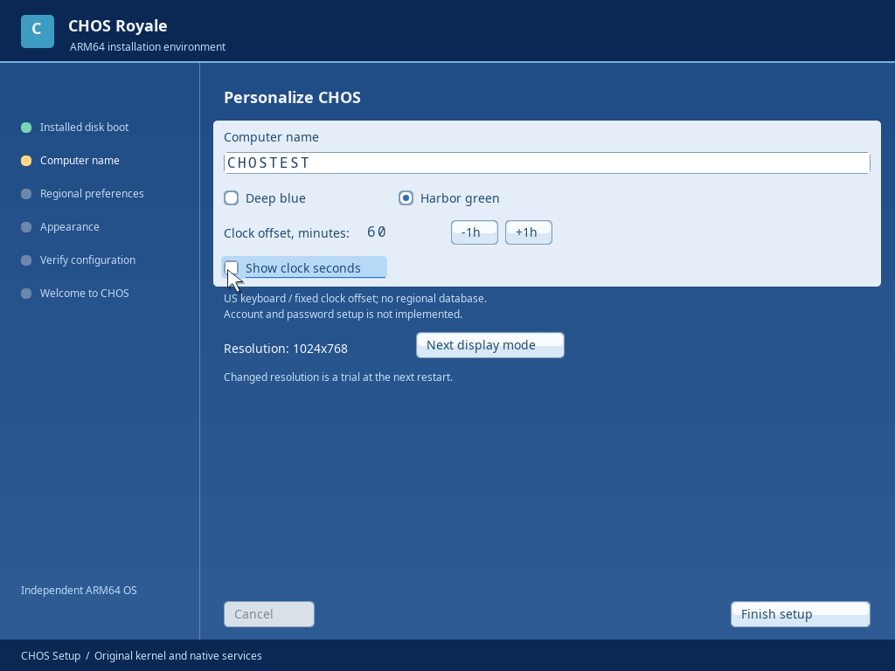
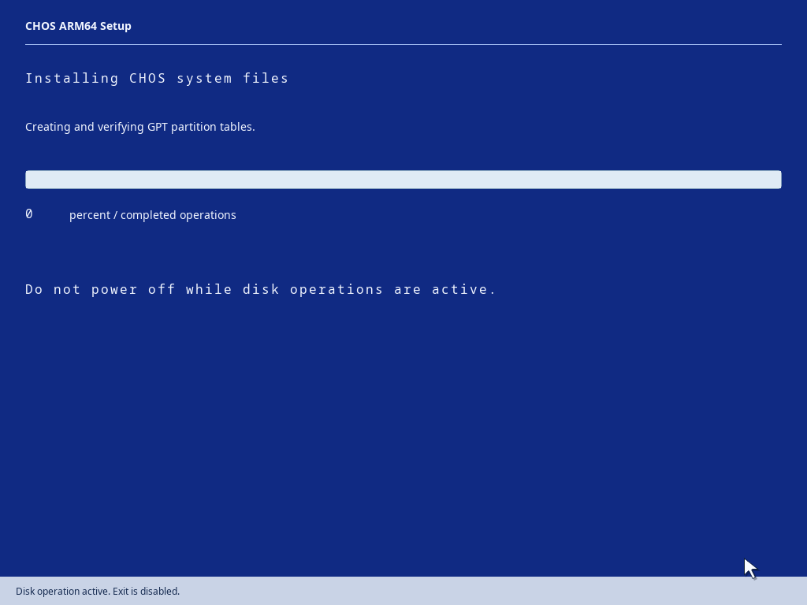
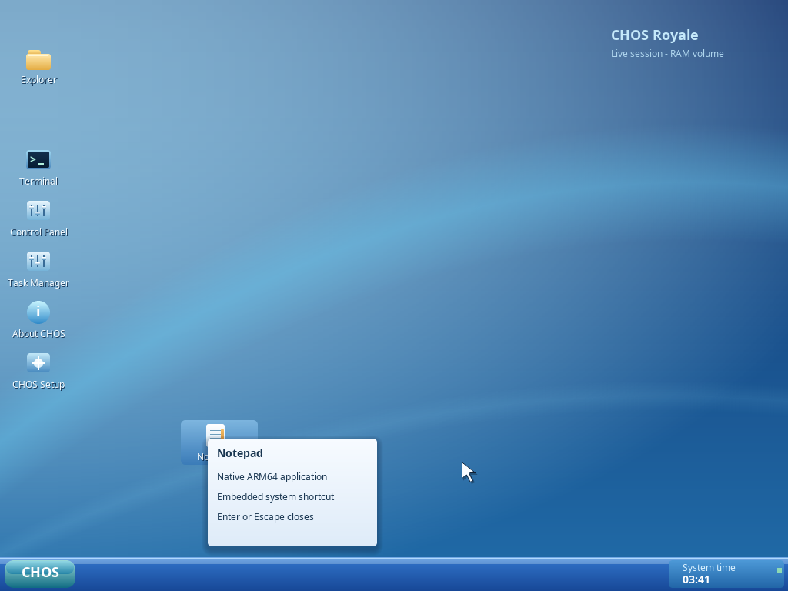
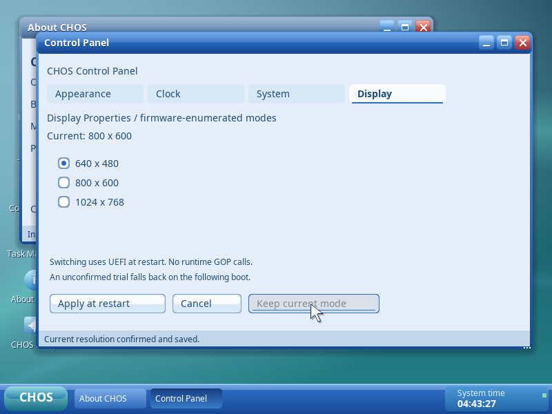

# Milestone 8 — installation and desktop continuation

The user reports actual M7I operation on an Apple M1 MacBook Air with VMware
Fusion: normal ISO boot, original kernel, graphical Setup, keyboard, mouse /
trackpad and Live Royale Desktop work. These are user-observed results, not a
new automated Fusion run. Persistent Fusion installation remains unverified:
the installation worker reports "Disk identity or write protection changed."
M7I artifacts and its source checkpoint remain the known-good backup.

## M8A investigation

The exact old predicate was `!nvme_recheck() || !nvme_writable()` in
`installer/service.c`. This ran in the kernel worker after confirmation, so the
error did not identify a typing failure. Every Identify, serial, namespace,
geometry and writable-state failure was collapsed into error 1.

Initialization trimmed only trailing spaces from the 20-byte Identify Controller
serial. Revalidation reconstructed space padding and compared it with the raw
Identify response. A serial ending with NUL padding therefore passed initial
inventory but failed even when the identical device answered again. This is a
reproduced source-level defect; the user's raw Identify data is unavailable, so
it is not yet proven to be the sole cause of the Fusion error.

Both initial discovery and revalidation now use one bounded canonicalizer.
Trailing spaces/NUL padding are equivalent. Leading/interior spaces remain
significant; embedded NUL/control bytes, blank identities and non-ASCII serials
are rejected. Canonical serial, namespace NGUID/EUI64, sector count, sector size,
namespace write protection, controller-ready status and diagnostic read-only
policy are checked. Failures have distinct codes and readable UI/serial messages.
No disk-identity or write-protection gate is removed.

Confirmation is exactly `ERASE`. It authorizes the existing kernel-held selected
disk and plan through the process/session token; it never supplies a replacement
disk identity. Optical boot, verified readable geometry, serial availability,
writable namespace, explicit destination and layout review remain prerequisites.
An installed boot disk cannot authorize the destructive installer.

Portable tests cover space/NUL padding, full-width serials, empty/malformed
identities, serial/namespace/geometry changes, read-only identity and exact
ERASE-only confirmation. QEMU installation and later sub-milestone results are
recorded below as they complete.

## Development sequence

M8B: persisted two-phase setup with actual disk-only reboot. M8C: desktop input
semantics and cursor. M8D: firmware-enumerated display choices and safe preference
handling. M8E: incremental Royale refinement. M8F: integrated regression,
reproducibility and versioned ISO publication. No sub-milestone is accepted from
its design alone; actual Fusion persistent-installation acceptance is separate.

M8A validation: `./scripts/container.sh make -j4 iso test-nvme test-setup`
passed. GCC AddressSanitizer/UndefinedBehaviorSanitizer NVMe parser tests passed.
`./scripts/container.sh python3 tests/install.py --sector 512` passed: real GPT /
FAT32 / CHFS writes, guest-requested reset, disk-only cold boots, settings and
Notepad file persistence, independent on-disk CRC/parser verification, rejection
of wrong confirmation without writes, and installed-boot disk erase exclusion.
This verifies the correction under QEMU, not the user's Fusion failure resolution.

## M8B — durable two-phase installation

The blue optical Setup now performs GPT, FAT32/CHFS format, actual kernel/EFI
copy, read-back verification, flush and continuation-marker commit. It displays
operation-based progress and actual per-file byte counts. It does not use an
elapsed-time estimate. Completion explicitly says to remove the ISO and restart.
Restart invokes the existing ACPI/PSCI guest power path.

A verified `/system/setup-stage` record survives power loss: `CHOS SETUP PENDING
2` resumes Royale configuration only from the matching installed ESP/CHFS disk;
`CHOS SETUP READY 1` bypasses setup. A missing marker is also refused: an interrupted install must never be mistaken
for a completed legacy system. Older installations keep their original boot pair;
there is no in-place M8 migration utility. Missing or malformed records fail into the existing temporary recovery
session; they never authorize repartitioning. Missing/incomplete first-stage
files likewise do not trigger automatic writes or retries. A retained ISO shows
explicit remove-media guidance and still requires selection, review and ERASE.

The installed graphical phase persists a valid computer name, theme, fixed UTC
offset, clock preference and optional firmware resolution trial. The US keymap
is fixed; locale databases, DST rules and authenticated accounts are unfinished
and labeled. Required configuration failures keep setup pending. A successful
verified commit leads to a separate Welcome to CHOS screen, then the desktop.
The existing CHFS two-root commit mechanism protects individual records, not a
multi-file transaction; an interrupted save may retain old or new complete
settings, with the setup marker controlling whether configuration repeats.

The new QEMU installation acceptance performs a guest reset, a separate disk-only
pending boot, termination before graphical completion, another disk-only boot
that resumes Setup, persisted configuration, Welcome, subsequent desktop boot,
Notepad save/read across cold boot and independent GPT/CHFS/CRC inspection.
The 512-byte preflight passed; full matrix results follow after integration.

## M8C / M8E — desktop and application interaction

Royale's existing colors, wallpaper, typography, window chrome, taskbar and native
widgets are retained. The original cursor is now a 28-pixel antialiased light
arrow with dark outline, shadow and tip hotspot; a 36-pixel option is available.
Only normal-arrow artwork is implemented in this checkpoint. Partial damage
includes the old/new cursor extents, with no per-frame allocation.

Desktop application shortcuts select on one click and open on a second click
within a configurable 250/500/750 ms interval and four-pixel tolerance. Enter opens
the selected shortcut. A four-pixel movement threshold distinguishes dragging;
positions are clipped above the taskbar. Arrange Icons and Auto Arrange are real
operations. Grid snapping and arbitrary desktop file objects remain unfinished.
A checksummed `/system/desktop` record persists icon positions, click timing,
Auto Arrange and cursor size on installed volumes. Live changes remain volatile;
write failures are displayed rather than reported as saved.

Right-click menus support pointer hover, matching press/release activation,
keyboard navigation, dismissal and screen-edge placement. Desktop menus expose
arrangement, refresh, Display Properties, theme settings, timing and cursor size.
New Folder is visibly unavailable because desktop filesystem objects are not
implemented. Shortcut menus provide Open and real shortcut properties; Rename /
Delete are disabled. Explorer receives a distinct right-click event and provides
folder navigation, copy, move/rename, confirmed deletion and filesystem-object
properties. File Open associations and cut/paste are unfinished. Copy refuses an
existing destination; it retains the existing bounded 4095-byte copy limit.
All real file operations use native CHFS syscalls. Accounts/permissions are not
yet implemented; properties do not imply otherwise.

Native testing caught a flat-kernel absolute string-pointer table crash before
publication. Fixed-width inline arrays replace the tables. Every kernel link now
checks object relocations and rejects absolute address constants. Only the two
specified image-header size/offset fields are allowed; this is not a general
runtime relocation mechanism.

## M8D — real firmware modes and safe reboot trials

The UEFI loader enumerates supported GOP width/height/stride/format entries into
a bounded, deduplicated boot-information list. Only those choices appear in
Display Properties. This QEMU firmware currently exposes 640x480, 800x600 and
1024x768; desired larger modes are not invented. There is no post-ExitBootServices
GOP call and no runtime display driver capable of changing the mode.

Installed M8 ESPs reserve a dedicated aligned 4 KiB allocation for a checksummed
32-byte `CHOS/DISPLAY.BIN`. A native request revalidates NVMe identity, GPT,
FAT metadata, directory entries and original EFI/kernel payload before touching
that slot. It never allocates FAT clusters or edits boot directory metadata at
runtime. Older ESP layouts refuse the operation. Live ISO Apply is disabled.

Apply saves a one-boot trial. Before mode selection, firmware consumes the trial
using the UEFI File Protocol and flushes its attempted state. Failure to write
that state prevents attempting the mode. After reboot, Keep Current Mode commits
the actual current resolution. Without confirmation, the next cold boot requests
1024x768 where supported; malformed preferences also retain safe defaults. Apply
and Cancel do not change the running framebuffer. If neither requested nor
fallback mode is usable, the loader retains an already supported active firmware
mode. A failed/unreadable ESP preference may require reinstalling a disposable
target; no general FAT repair utility is claimed.

## Validation and release gate

Commands: `./scripts/container.sh make -j4 iso test-installer test-desktop
 test-graphics`, `./scripts/container.sh python3 tests/install.py --sector 512`,
new `tests/desktop_m8.py`, `tests/explorer_context.py`, `tests/display_m8.py`, and
`bash scripts/checkpoint.sh` for the full existing suite, host sanitizers and
clean committed-source reproduction. Final integration results and source/image hashes are recorded below. M8 Fusion persistent installation and
new desktop/resolution behavior require actual user testing; QEMU success alone
does not close that acceptance criterion.

The display preflight found a standards-level FAT interoperability issue: UEFI
updates access/modify timestamps and may set a parent directory's archive bit
when writing the trial record. Verification now allows those non-identity fields
while retaining exact names, type bits, allocation, cluster chains, lengths,
boot metadata and payload checks. Host tests distinguish legitimate timestamps
from a changed directory cluster. No arbitrary directory/payload changes are
accepted.

The interrupted-install audit also found a missing-marker ambiguity. M8 now
requires a valid continuation record before mounting its installed system as
ready. A byte-valid CHFS fixture with only that record removed reproduced the
pre-fix problem: the old candidate entered a persistent desktop. A new cold-boot
regression requires temporary recovery and zero writes instead. This deliberately
refuses automatic migration of marker-less legacy installations; their existing
boot pair/backup remains usable. The source checkpoint was revised before final
integration acceptance.

## Final automated acceptance — 2026-10-24

Source checkpoint: `475c3a737295748a0bd2000d57f664c3fb877e81`.
Runtime source paths are byte-identical to `dfaa4f3`; the final commit corrects
only the growth-test harness's obsolete three-boot assertion to five boots.
The initial whole-suite run stopped at that assertion after all five actual
boots succeeded. The failed growth group and all remaining gates were rerun;
earlier passing coverage was retained against the unchanged binary. This is
recorded in `evidence/m8/m8-validation-resume.json`, and the original assertion
failure remains visible in the validation log. No runtime failure was hidden.

All automated gates now pass:

| Gate | Evidence/result |
|---|---|
| Full QEMU coverage | 109 distinct recorded QEMU command lines; original suite plus expanded installation and M8 cases |
| Portable host checks | 20 programs; both actual ELF payloads verified |
| Memory safety | GCC AddressSanitizer/UndefinedBehaviorSanitizer checks pass |
| Native installation | Both 512/4096 sectors, EL1/GICv2 and EL2/GICv3; bridged NVMe; five boot steps per installation |
| Interrupted installation | First-stage write failure/interruption/reconfirmation; second-stage failed save, cold continuation, missing/invalid marker with zero writes |
| Desktop input | Virtio relative and USB absolute; selection, double-click, dragging, Enter, properties/menu dismissal and cursor restoration |
| Icon persistence | Saved positions survive disk-only cold boot |
| Explorer context actions | Folder opening, real properties/copy and existing-destination overwrite refusal |
| Display preference | Six real boots cover trial, unconfirmed fallback, confirmation, retained mode and corrupt-record fallback |
| Existing hardware/kernel | MMU/EL/IRQ/ELF/IPC/storage/USB refusal/disconnect/hub/nonzero-bus coverage preserved; controlled large-image installed boot passes |
| Reproduction | All three ISOs byte-identical after a clean build from committed source |

The package contains **187 actual QEMU PNGs**, **61 fresh metadata reports** and
**371 hashed evidence files**. [Summary](evidence/m8/summary.json),
[validation log](evidence/m8/validation.log), [sanitizers](evidence/m8/sanitizers.log),
[reproduction](evidence/m8/checkpoint-reproduction.json),
[evidence hashes](evidence/m8/files.sha256).

Normal ISO: **[Download CHOS-ARM64-M8.iso](https://raw.githubusercontent.com/garythurman-boop/Test-CHOS/main/artifacts/milestone-8/CHOS-ARM64-M8.iso)**.
[All image checksums](../artifacts/milestone-8/SHA256SUMS).

| Image | Bytes | SHA-256 |
|---|---:|---|
| CHOS-ARM64-M8.iso | 17154048 | `8a903ab0ab868c79aa54cd3c1a23fa743ad2eef4ab28703ecb37c00b4928026d` |
| CHOS-ARM64-M8-DIAGNOSTIC.iso | 17154048 | `ce0cbc9d401b365161cb1a9ac547752a4d2dda2266bc7f0f21d9c06fca72792f` |
| CHOS-ARM64-M8-INPUT.iso | 17154048 | `0def67421ada8901cdd27710fcf52fdfa6c16fef928380bd25189953ae571fd7` |

Normal ISO SHA-256 is `8a903ab0ab868c79aa54cd3c1a23fa743ad2eef4ab28703ecb37c00b4928026d`.
The normal ISO is the installer; optional INPUT and DIAGNOSTIC images are read-only
hardware/input tools. The M7I backup and original USB/input, interrupt, memory,
ARM64 and CHFS source paths are unchanged. NVMe command/transfer/read/write/flush
functions are unchanged; identity formatting/revalidation is the intended change.
[Preservation check](evidence/m8/m8-preservation.json).

Measured QEMU scope: kernel file 315,680 bytes, declared image memory 638,976 bytes,
guarded stack reservation 73,728 bytes. The 512 MiB two-app test reports 11,680 KiB
allocated from 489,568 KiB managed conventional RAM. This excludes other reserved
firmware/device memory and is not total system memory consumption. Desktop
readiness was 15.373 seconds including firmware, self-tests and Live selection.
The bounded idle observation consumed 0.93 host vCPU-thread seconds over 10 seconds
under TCG (9.3% of one host core), not a native Fusion guest CPU measurement.

Actual framebuffer captures:

| Sub-milestone | Acceptance scope |
|---|---|
| M8A | Identity defect corrected and regression-tested; exact Fusion failure resolution awaits target retest |
| M8B | Genuine two-phase installation and persistence verified under QEMU |
| M8C | Implemented cursor/shortcut gestures/menus/layout persistence verified; optional file-object and cursor features remain |
| M8D | Firmware-mode choices and safe reboot trial/confirmation verified under QEMU |
| M8E | Incremental Royale/native-menu refinements; further small-window/interaction polish remains |
| M8F | Automated gates, reproduction and packaging pass; manual Fusion acceptance remains open |

## Source areas

Boot firmware changes are in `boot/uefi/main.c`, `boot/uefi/efi.h`, `include/boot.h`
and `include/display_mode.h`. Installer/storage changes are in `installer/service.c`,
`installer/policy.c`, `installer/fat32.c`, `drivers/storage/nvme.c` and
`drivers/storage/nvme_format.c`. Native presentation and interaction changes are
in `applications/setup/main.c`, `applications/control-panel/main.c`,
`applications/explorer/main.c`, `applications/desktop/main.c`, `desktop/desktop.c`,
`desktop/window-manager/model.c` and `desktop/graphics/primitives.c`. ABI/header,
Makefile, validation, sanitizer-compatible portable tests, real QEMU interaction
scripts and documentation accompany those changes. `git show --stat` on the
source checkpoint gives the complete file list.

## Acceptance scope and remaining work

The development build is not CHOS 0.1. QEMU evidence covers real native code and
real persistent virtual-disk operations; it does not substitute for Fusion
installation acceptance. The user-confirmed M7I Fusion input result is preserved.
The actual Fusion install error may have another cause in addition to the
reproduced serial-padding defect; a new precise error screen should identify it.

Only the original arrow cursor and built-in application shortcuts are implemented.
Arbitrary desktop file objects, grid snapping, additional cursor shapes, file
associations and clipboard cut/paste are unfinished. Some narrow application
layouts still clip controls; maximize the window when needed. The fixed US
keyboard, fixed UTC offset and two themes are real; locale databases, DST rules,
authenticated accounts and per-user permissions are absent. Runtime display
switching, general FAT repair, larger CHFS capacity, USB3/replug recovery, SMP and
networking remain future milestones. Firmware consumption of an explicitly
requested display trial is an authorized pre-kernel ESP write; native diagnostic
write guards apply after that boot stage. Optical diagnostic images do not carry
such a writable preference file.

Next: run the complete disposable-disk installation, disk-only graphical setup,
persistent document, desktop gesture and resolution-trial sequence on the user's
Fusion/M1 configuration. Record the precise ISO checksum and results. Resolve
any target failures before declaring M8 fully accepted, then continue filesystem
recovery/capacity and account-security work from the preserved original kernel.

Installed boot currently uses `EFI/BOOT/BOOTAA64.EFI` on the GPT ESP; firmware
Boot#### NVRAM registration is not implemented. QEMU automatically finds this
path. If Fusion does not automatically boot the installed disk, capture that
firmware result and select the file manually for diagnosis rather than erasing
again. Automatic Fusion installed boot is a separate acceptance gate.
