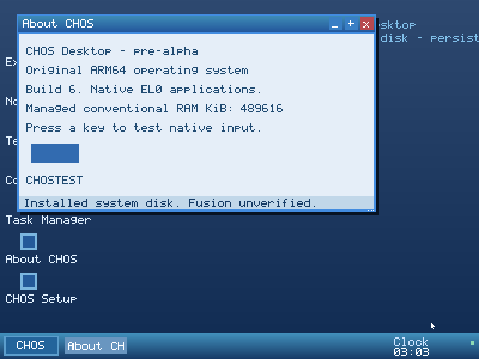
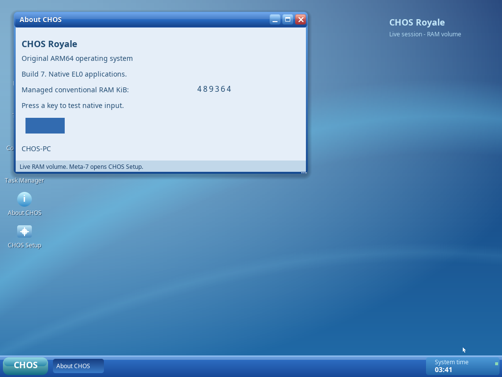
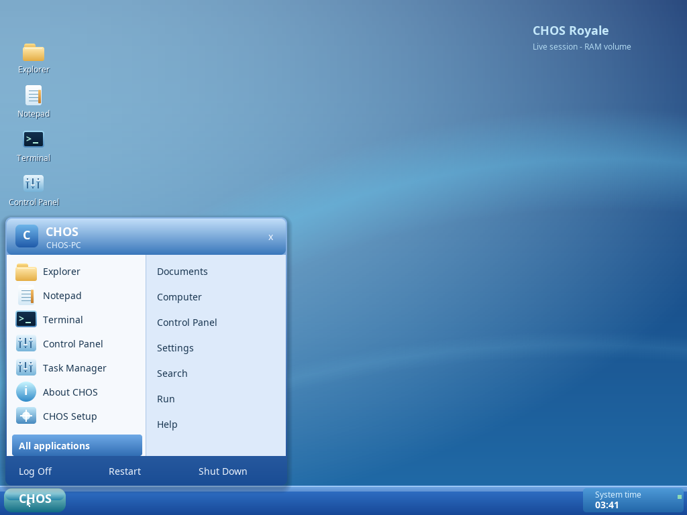

# CHOS Royale: visual foundation

Royale is original native CHOS software rendering. The visual reference is early
2000s blue desktop design; no Microsoft font, image, icon or source is included.
The existing window/event/process system is retained. This is a tested visual
foundation, not completion of every requested widget or installer feature.

## Renderer and typography

`include/graphics.h` defines source-over RGB blending, a clipped ARGB image blit,
vertical gradients, rounded rectangles with 4×4 edge coverage, soft layered shadows,
and bounded grayscale text. `include/royale.h` starts the palette. Surfaces retain
an explicit framebuffer clip and stride. Transparent blits preserve destination
pixels at alpha zero. These are software primitives, not GPU acceleration or a
full translucent per-window compositor.

Five cached Noto font styles provide proportional body/bold/title/small text and
fixed-advance editor/terminal text. Normal text is baseline aligned with its
style's metrics. ASCII 32–126 is supported; other bytes map to `?`. The diagnostic
console retains its small emergency bitmap font. The kernel validates all glyph
records and offsets once before use, and blends each A8 coverage sample directly.
No allocation or outline rasterization occurs while painting.

The checked-in A8 cache is 48,974 bytes. Source outlines and their SIL OFL 1.1
license are in `assets/fonts`. Regeneration requires Pillow 12.3.0 with FreeType 2.14.3:

```sh
python3 scripts/mkfonts.py
```

Ordinary builds use the checked-in cache and need no Pillow/FreeType. The manifest
records source hashes, sizes, advances and output hash. Bundled outlines came from
Debian's `fonts-noto-core`/`fonts-noto-mono` packages; upstream is
https://github.com/notofonts/noto-fonts. Fonts/cache remain under OFL; CHOS source
retains MIT. The ISO carries CHOS/FONT-OFL.TXT, the kernel embeds the notice, and
native installation saves `/system/font-ofl` alongside `/system/license`.

## Shell and applications

Glossy rounded title bars, vector minimize/maximize/close controls, subtle shadows,
blue taskbar, selected task buttons, time area and a two-column Start menu use the
same renderer. The menu's pinned left column launches real native applications;
right-column shortcuts preserve the existing actions. All applications is keyboard
and pointer accessible. Search/Help remain documented provisional aliases; Run
opens Terminal. These are not new dedicated Search/Run/Help services.

The wallpaper is original analytical artwork cached in one RGB surface. Themed
blue/green backgrounds do not load external image files yet. Icons are original
small color vector drawings; a complete size-aware icon library remains work.
Native apps use proportional labels/status text and cached fixed-advance editing
text. Shared additive draw commands provide rounded buttons and UI text. Explorer
and Notepad toolbar labels align with their actual hit regions. Setup's Continue
button uses the existing guarded state machine, not a second installer path.

Before/after screenshots are actual QEMU framebuffer captures, without compositing
or retouching:

| M6B | Royale foundation |
|---|---|
|  |  |



## Damage and measurements

The original software backbuffer remains. Pointer-only movement outside chrome
invalidates the union of old/new cursor bounds; rendering and framebuffer writes
are clipped to that region. Application presents, window operations, menus, theme
changes and clock ticks still invalidate the whole screen. The wallpaper cache
avoids recomputing the artwork on each paint. No repaint-time heap allocation is
introduced. This intentionally leaves broader window damage coalescing for later.

SYS_RENDER returns frames, copied pixels, partial frames and last/total paint
microseconds measured with the architectural counter. Task Manager displays the
actual partial repaint count and last paint time. QEMU TCG measurements include
emulation costs and are not native Apple Silicon performance or idle CPU claims.
At 1024×768 each RGB surface occupies 3 MiB; wallpaper plus backbuffer is 6 MiB.
Allocator totals exclude firmware/non-conventional reservations. See milestone-6c
for recorded values.

Remaining visual work: pressed/disabled/focus states across widgets, reusable
checkboxes/radios/scrollbars/tabs, fuller list views, tooltips, multi-size icons,
wallpaper file loading, HiDPI scaling, richer installer layout and broader dirty
regions. These should follow the same native tested path.
