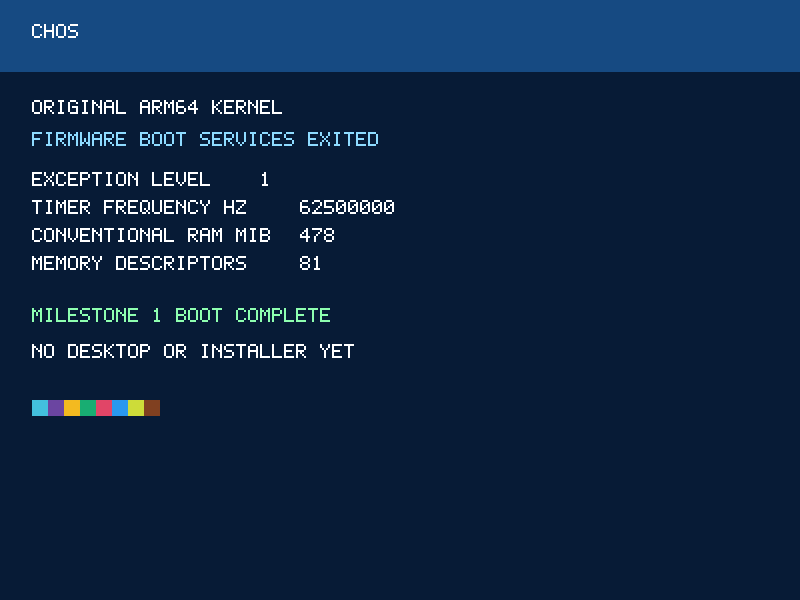

# Milestone 1 validation — 2026-10-22

**Historical report for commit fec1183 (M1).** Current M2A results are in
[milestone-2a.md](milestone-2a.md); current validation is recorded in [milestone-7f.md](milestone-7f.md).

Executed in this cloud workspace using the repository Docker toolchain.

| Acceptance criterion | Result |
|---|---|
| ARM64 EFI loader and original kernel compile/link | PASS, warnings treated as errors |
| ISO generated and recognized as UEFI El Torito optical boot media | PASS, bootable EFI catalog entry, no emulation |
| ISO boots via AArch64 UEFI in QEMU at 512 MiB | PASS, kernel banner and completion pixels verified |
| ISO boots via AArch64 UEFI in QEMU at 1024 MiB | PASS, same functional check |
| Missing kernel produces useful firmware console error | PASS, expected error observed |
| Two successive ISO rebuilds produce identical SHA-256 | PASS |
| Installer executes | NOT IMPLEMENTED / NOT RUN |
| Installation to virtual disk | NOT IMPLEMENTED / NOT RUN |
| Installed system reboots without ISO | NOT IMPLEMENTED / NOT RUN |
| VMware Fusion ISO, device, installation and reboot tests | NOT RUN |

Three QEMU tests passed; none skipped. Elapsed emulator-to-observation times were
5.639 s at 512 MiB, 5.639 s at 1024 MiB, and
5.604 s for the expected missing-kernel error. These include firmware
and TCG emulation time; they are not native CHOS performance measurements.

At 512 MiB the actual framebuffer reported EL1, timer frequency 62,500,000 Hz,
478 MiB of firmware conventional memory, and 81 memory descriptors. These values
are observations of this QEMU configuration, not claims about Fusion or total
kernel memory use. Loader reserves 1 MiB for kernel/BSS/temporary stack; payload
is 2,664 bytes, EFI executable is 5,120 bytes, ISO is 17,154,048 bytes.

Tool versions: Clang/LLD 19.1.7; QEMU 10.0.13; EDK II package
2025.02-8+deb13u1; xorriso 1.5.6; mtools 4.0.48. Base container digest is pinned
in Dockerfile. APT packages remain version-variable on future image builds.

ISO SHA-256:

```
063435ae209643c00c184d799415433bd7d880521b6b37e35b8b3a926119eb2b  build/CHOS-ARM64.iso
```

Commands:

```sh
./scripts/container.sh image
./scripts/container.sh make
./scripts/container.sh bash scripts/validate.sh
```

The validator preserves subprocess failures and checks actual guest framebuffer
pixels after ExitBootServices and memory-map validation. It also boots an ISO
with an intentionally omitted kernel and verifies its explicit loader error.
No zero-test substitute or QEMU direct-kernel boot is used.

Logs (console transcripts have ANSI escapes removed and LF line endings), machine-readable results, binary-header/catalog inspection and the real
512 MiB kernel screenshot are in [evidence/](evidence/). The initial unsuccessful
experiment faulted at kernel entry because data memory was non-executable; this
was corrected with EfiLoaderCode and is described in release notes.


